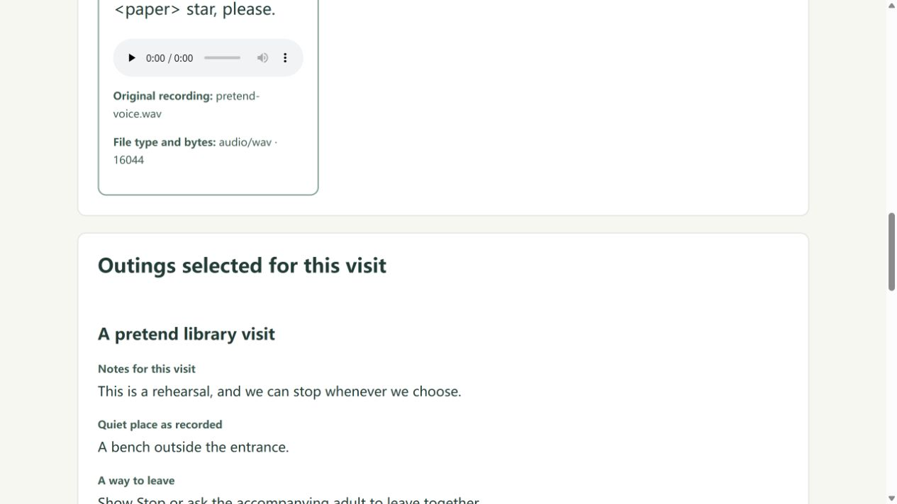

# ToolJovia Task Worksheets

A free set of editable worksheets for planning project work, recording checks and preparing deliverables.

Use it to connect the workflow paths you declare, the test records you supply, the work still open, and the person responsible for the handoff decision. It prepares a reviewable record; it does not run or approve an automation.

[Read the worksheet guide](https://tooljovia.com/automation-handoff/) · [Download version 0.3 — ZIP, 19 files](https://tooljovia.com/assets/downloads/tooljovia-task-worksheets-v0.3.zip)

No account, email address or optional analytics consent is required to use the free kit.

You can also [browse the editable files in `kit/`](kit/).

## Five-minute orientation

1. Download the ZIP and open `CLIENT_HANDOFF_CHECKLIST.en.md`. Name the workflow version, intended environment, operating owner and decision owner.
2. Skim `CLIENT_HANDOFF_WORKED_EXAMPLE.en.md`. Compare the synthetic A/B records: B has three matching branch records, but the owner's signoff remains unrun and a filename requirement has no test.
3. Open `03-test-record.md`. Record expected and observed results separately. Leave checks without execution evidence marked **unrun**, or identify them explicitly as desk reviews.
4. Open `04-client-handoff.md`. List the included deliverables, unresolved work, responsible owners and the decision still needed. Keep real evidence in the project's authorized location and use neutral references here.
5. If useful, open [Workflow Branch Test Coverage](https://tooljovia.com/tools/workflow-branch-test-coverage/) and [MVP Acceptance Traceability Builder](https://tooljovia.com/tools/mvp-acceptance-traceability-builder/). Enter authorized, non-confidential records and transfer relevant records manually between the workbenches.

This is a quick orientation, not a promise to validate a client project in five minutes. Actual execution, environment checks and the authorized owner's decision require separate work.

## Three files to start with

These paths are inside the ZIP:

| File | Use it for |
|---|---|
| `CLIENT_HANDOFF_CHECKLIST.en.md` | Scope, ownership, access, required checks and the handoff decision. |
| `03-test-record.md` | Expected paths, actual observations, pass/fail/unrun status and evidence references. |
| `04-client-handoff.md` | Deliverables, open issues, operating responsibilities and recipient review. |

## What the example proves

`DEMO-AUTO-001`, its A/B inputs and its saved worksheet exports are synthetic practice material. They are not a client case study, a live workflow execution, a customer approval or evidence of paid use. Matching all supplied branch records does not resolve missing signoff or an uncovered requirement.

The workbenches organize the records you enter. They do not connect vendor accounts, migrate credentials, run workflows or verify a client's environment. There is no automatic project loading or shared account history. Use the automation platform's execution tools for runtime debugging.

Do not upload workflow files, credentials, API keys, tokens, client data or confidential execution records to a repository or feedback email. Keep real execution evidence in its authorized project location. Any optional cost examples are hypothetical, not observed savings, income or profit.

## Photo issues to hand over

[View the photo report demo](examples/photo-issue-report/): three made-up issues delivered as a PDF, a CSV checklist and an editable JSON draft. Try the [free Photo Issue Report Builder](https://tooljovia.com/tools/photo-issue-report-builder/) with up to 10 items, using your own authorized images.

PDF text supports a limited Latin character set. These optional sample files are separate from the 19-file version 0.3 ZIP.

## Document images to PDF

[Try the two-page document demo](examples/images-to-pdf/): download two synthetic PNG inputs and the PDF exported from the [free Images to PDF tool](https://tooljovia.com/tools/images-to-pdf/). Adjust four corners, preview and adopt each page, then combine the pages locally in your browser.

This example is separate from the 19-file version 0.3 ZIP.

Planning a scoped service? [Read the service proposal example](examples/service-proposal/) for a fictional USD 1,200 setup package, with separate labor-cost and client-billing assumptions.

Make a [draft invoice](https://tooljovia.com/tools/draft-invoice-document-builder/): start with the default **Fill in fields**, enter line items, choose decimal places and paper size, then select **Run tool** to generate an HTML draft. Download it, reopen and check it before printing from your browser. **Advanced JSON** remains available.

Handing over subtitles? [Compare this two-cue SRT and WebVTT pair](examples/subtitle-workbench/) with a clear 125 ms shift, then try the existing Subtitle Workbench.

Compare repeated CSV rows with [Duplicate-preserving CSV Reconciler](https://tooljovia.com/tools/csv-multiset-reconciler/). For a fictional example, put `day,sku,channel` in both CSV headers. Add `2026-01-01,A,web` twice under Before CSV and once under After CSV. Choose `selected-columns`, enter `["day","sku","channel"]`, and select **Run tool**. In the JSON result, `before: 2`, `after: 1`, and `delta: -1` mean one fewer occurrence, not a change in quantity or money. Other columns are ignored in this mode.

**Share a reconciliation:** Start with the [earlier fictional example](https://github.com/yeqingdeng23-boop/tooljovia-automation-handoff-kit/blob/7d1d74dd31aa7bd01772da49ed39cf0fe820d659/README.md#document-images-to-pdf) and the [CSV Reconciler](https://tooljovia.com/tools/csv-multiset-reconciler/). For a larger fictional check, give both CSVs the header `day,sku,channel`. In **Before CSV**, enter `2026-11-01,A,retail` three times and `2026-11-02,B,online` once; in **After CSV**, enter them once and four times respectively. Set **Tuple identity** to `selected-columns` and **Selected identity columns JSON** to `["day","sku","channel"]`, then choose **Run tool**. The result shows 4 before, 5 after, 2 missing and 3 extra occurrences. Delta is after minus before occurrences, not a change in quantity or money; other columns are ignored. Choose **Download discrepancies CSV** for bounded discrepancy details and **Download** for the original JSON. Check `detailsTruncated` before sharing. Import identity columns as text: spreadsheet formula protection may add a tab to a value.

Extract email candidates from authorized text with [Extract Emails](https://tooljovia.com/tools/extract-emails/). For a fictional example, paste `alpha@example.com alpha@example.com beta@example.org` into **Text**, set **Repeated addresses** to **Keep first exact occurrence** and **CSV export policy** to **Guarded CSV**, then click **Run tool**. The result lists `alpha@example.com` and `beta@example.org` once each. Click the separate **Download candidates CSV** button to save `email-candidates.csv`, with one `email_candidate` column; import the column as **Text**. Guarded CSV withholds the whole CSV if any candidate starts with `=`, `+`, `-` or `@`. Matching is case-sensitive. Candidates are not proof that addresses are valid or that you may contact them.

**Choose a long-ID workflow.** Use the result you need to choose a tool.

| Result you need | Tool | What to check after selecting **Run tool** |
|---|---|---|
| Readable JSON | [JSON Formatter](https://tooljovia.com/tools/json-formatter/) | Indentation changes; the original numeric spelling remains visible. |
| Compact JSON | [JSON Minifier](https://tooljovia.com/tools/json-minifier/) | Whitespace outside strings is removed; long IDs and spaces inside strings remain. |
| A JWT's header and payload | [JWT Decoder](https://tooljovia.com/tools/jwt-decoder/) | Inspect original numeric spellings and the **Not verified** warning. Decoding does not authenticate a user. |
| CSV for a spreadsheet | [JSON to CSV](https://tooljovia.com/tools/json-to-csv/) | Use original quoted IDs only where strings are allowed; import the ID column as **Text**. |

For a fictional JSON check, paste this into JSON Minifier and select **Run tool**:

```json
{ "id" : 9007199254740993, "ratio": 0.12345678901234567890123456789, "n": -0, "e": 1.2300e+04, "text": "a  b \u0061 \"x\"" }
```

The compact result should be exactly:

```json
{"id":9007199254740993,"ratio":0.12345678901234567890123456789,"n":-0,"e":1.2300e+04,"text":"a  b \u0061 \"x\""}
```

Choose JSON Formatter when you need indentation instead. Review the result before using **Copy result** or **Download**. Keeping the written number is not arbitrary-precision arithmetic; another parser or spreadsheet may still change it. Already-rounded digits cannot be reconstructed. JSON to CSV retains the original numeric spelling of direct and nested values, including long integers, decimal trailing zeros, exponents and negative zero, within its finite JavaScript-number and input limits. It does not provide arbitrary-precision arithmetic. Spreadsheet-safety prefixes may alter cells, and spreadsheet imports can still round numbers or change types; import identifiers as Text and review the result.

For JWT inspection, paste this fictional, deliberately unsigned token into JWT Decoder, including the trailing dot, then select **Run tool**:

```text
eyJhbGciOiJub25lIn0.eyJzdWIiOiJkZW1vIiwiZXhwIjoxNzM1Njg5NjAwfQ.
```

The decoded fields are `header.alg: none`, `payload.sub: demo`, and `payload.exp: 1735689600`. The expiry is displayed even though it is past. A readable payload is not proof of identity. Verify the signature, allowed algorithm, expiry, issuer and audience in your authentication system. Do not share real bearer tokens in this repository or feedback.

Export identifiers with [JSON to CSV](https://tooljovia.com/tools/json-to-csv/). In the original JSON, put long IDs in double quotes, for example `[{"id":"9007199254740993"}]`, then select **Run tool**. When importing the CSV into a spreadsheet, set the ID column to **Text**. Opening the CSV directly may round long IDs or remove leading zeros.

[Try the two-file text replacement example](examples/batch-text-replace/): download two fictional inputs, change `ACME` to `NOVA` with the [free Batch Text File Replacer](https://tooljovia.com/tools/batch-text-file-replacer/), and compare the saved result ZIP. One file changes; the other stays unchanged.

[Plan a gathering with Shared Table](examples/shared-table/): try a fictional shopping list and budget with an editable example.

[Keep a handwritten recipe note beside your own words](docs/handwritten-keepsakes-recipe-card.md): make a free keepsake card with your own image and a manual transcription, then save a printable HTML edition.

[Test a robots.txt exception](docs/test-a-robots-txt-exception.md): follow a fictional Allow and Disallow example, inspect the winning rule, and compare a second path.

## Find Your Pet's Soul

[Explore the free fictional English example in Telegram](examples/pet-soul-finder/): open the ToolJovia bot and follow the guide. Telegram requires an account.

[Try Find Your Pet's Soul](https://tooljovia.com/pet-soul/) for a personal reflection based on your pet's story and, optionally, the faith perspective you choose. Your photo cards and editable letter remain free and work locally in your browser. Use your own authorized photo, select an excerpt and save a PNG keepsake; save the current full letter separately as TXT.

**Preview the separate Complete work format:** [Read two complete fictional reports and support letters](https://tooljovia-pet-soul-bot.shiye-cloud-memory-bridge.workers.dev/examples/juniper-full-booklet.html). These samples are separate from the free local workspace demo and are not customer work.

The examples show selected original passages and separate editable support letters, with TXT and printable HTML formats. Report-note prompts are for offline writing in TXT or print; they are not editable report fields in the Mini App.

**Read one actual chapter before deciding to pay.** Add the memories you want to use in the free workspace. If you want to continue to **Prepare your reflection**, explicitly choose to save that draft on your device. On the preparation page, choose whether to send the draft's text to ToolJovia, then review your free chapter, the passages it draws on and references for your chosen perspective. Your photo is not sent. Previewing does not request payment.

The optional complete personal soul-journey reflection costs **USD 59.90 once**, with no subscription. Before checkout, the page lists exactly which additional sections your current material supports and the supporting editable letter. Save the delivered work as TXT or printable HTML with references. [Review current availability and same-browser access requirements before checkout](https://tooljovia.com/pet-soul/checkout/). The free workspace and photo-card downloads remain free.

For an earlier illustrative example, read the fixed fictional Juniper reflection: [TXT](https://tooljovia.com/pet-soul/examples/juniper-full-booklet.txt) · [HTML — view or print](https://tooljovia.com/pet-soul/examples/juniper-full-booklet). It includes editorial comparisons that are not part of the current report format. All names, memories, chosen beliefs and experiences in this demonstration are invented. Its readings and personal associations do not verify an afterlife location, reincarnation or a message.

[Read the current fictional reflection report example](https://tooljovia.com/pet-soul/examples/current-reflection-example.html). It is an example, not customer work.

The earlier letter-only export examples remain available: [juniper-letter.txt](https://tooljovia.com/pet-soul/examples/juniper-letter.txt) · [juniper-letter.html — view or print](https://tooljovia.com/pet-soul/examples/juniper-letter). They are separate legacy examples, not the complete reflection's current report format. None of these samples is customer work.

[Open the free memorial workspace](https://tooljovia.com/pet-soul/) to try your own material. You can keep using its photo cards and downloads without purchasing.

For your own photo keepsake:

[Follow the free photo keepsake guide](docs/pet-photo-keepsake-guide.md) for framing and download steps.

1. Create your free personal preview with your own photo, then edit your memorial letter.
2. In the card text-source control, explicitly choose **Current memorial letter**, then select the excerpt you want on the card.
3. Save the PNG keepsake with your own photo. Save a separate TXT copy if you want the full current letter.

This personal workflow is separate from the fictional Juniper example above. Use the existing feedback links below only to describe ordinary steps or controls; omit photos, personal letters, beliefs, dreams and loss stories.

## A two-minute smile practice

Before a photo or video call, [follow the SmileCraft two-minute quickstart](docs/smilecraft-two-minute-practice.md). It walks through the free browser preview, an optional local camera mirror and a no-camera option. No account or payment is required.

## Once, My Way

[Open Once, My Way](https://tooljovia.com/once-my-way/) and choose one of 50 adapted classics. Follow the story choices, edit the title or a sentence, and keep your version on your browser's local shelf. You can download an illustrated HTML keepsake of the path you selected; the export records that path and does not add new interactive branches.

[Read a finished fictional example](docs/once-my-way-finished-example.md) to see one complete path before making your own.

## Our Story

[Open Our Story](https://tooljovia.com/our-story/) to create original family stories in four guided studios: Family Relay, Little Days, Drawing Worlds and When We Were Small. Keep your work on your browser's local bookshelf and save files. It is free, with no account needed to create.

[Follow the Family Relay guide](https://tooljovia-notes.blogspot.com/2026/10/make-little-family-story-with-family.html) to make and keep a fictional family story example.

[Fill in the Family Relay worksheet](docs/family-relay-worksheet.md), then compare a complete fictional example.

## Wonderpatch paper theatre

[Open Wonderpatch](https://tooljovia.com/wonderpatch/) and [try a fictional two-scene play](examples/wonderpatch/). Edit its dialogue and keep an editable copy. Free; no account or email required.

## Autism Everyday Support

[Open the free Autism Everyday Support suite](https://tooljovia.com/tools/autism-everyday-support/) to make communication cards and outing plans, then save selected material in a care pack. Work stays in your browser. Before sharing an export, review the entire file, including any linked cards and embedded images or audio.

**Fictional demo — Outings section**



This screenshot shows one section of a multi-part care pack. All names, activities and media are fictional examples.

[Make your own cards and outing plan](https://tooljovia.com/tools/autism-everyday-support/).

## Optional task feedback

[Discuss a current task on GitHub](https://github.com/yeqingdeng23-boop/tooljovia-automation-handoff-kit/issues/new?template=current-task.yml). This opens the existing task form. Issues are **public** and require GitHub sign-in. Your GitHub username and issue content are public; review the content before you submit it. The link does not include your tool inputs, results or files.

You can request an assessment of a bounded JavaScript or data-conversion fix. Describe the goal, a synthetic reproduction, expected results and acceptance checks, your budget and currency, and the desired deadline. We assess fit before agreeing the scope, fee, delivery date, acceptance checks and payment terms. Posting is not an order or a promise of a fix. We use AI assistance; the linked tools are our own projects, not customer case studies.

Review an [AI-assisted CSV header validation fix and its regression evidence](https://tooljovia.com/assets/downloads/tooljovia-isolated-csv-header-fix-evidence.txt). This is our own example, not a client case.

Use synthetic examples and neutral descriptions only. Do not post original tool inputs or results, real files, photos, client records, credentials or confidential details. For personal tools, omit personal letters, beliefs, dreams and loss stories. If the task cannot be described publicly, do not post it here.

The worksheets and tools remain free. The free kit does not include paid support or implementation; any separately agreed work is optional. No GitHub account is required to use the kit.

As a backup, [open an email draft](mailto:yeqingdeng23@gmail.com?subject=ToolJovia%20task%20feedback) with a general, non-confidential task description and no attachments. Only a fixed subject is supplied. Review and send it yourself; no message is sent automatically and no marketing subscription is created.

## Version and existing use terms

The version 0.3 ZIP is 19,803 bytes. Its SHA-256 identifies the specific archive referenced here:

```text
bd5098824201db45bdf69d898d3e709bffbceb259b3a084918fe8eb5567992ad
```

The README inside that archive states:

> Version 0.3. These worksheets and checklist are provided for use and adaptation in your own or client projects. Keep the synthetic example identified as a demonstration. No paid support, implementation or outcome promise is included.

Those terms are preserved. This README declares no additional license.
