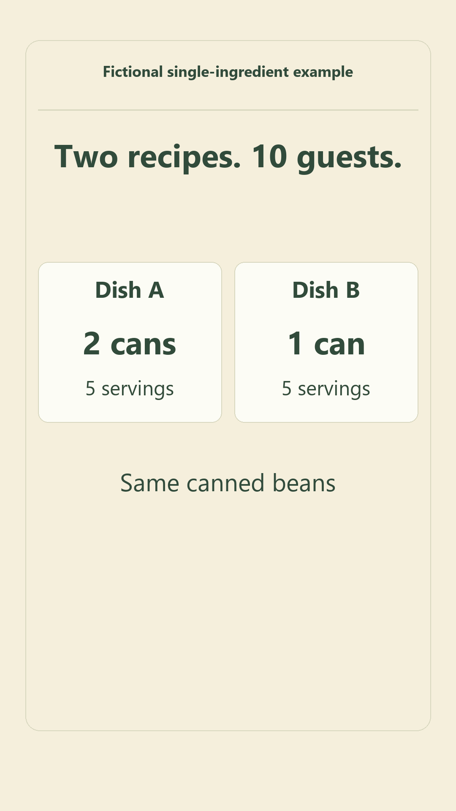

# A gathering shopping plan

[Open Shared Table](https://tooljovia.com/shared-table/) — free to use without an email address.

1. Save the [fictional example](fictional-ten-guests.shared-table.json) with GitHub’s **Download raw file**.
2. In Shared Table, choose **My gatherings → Open a saved copy**, select the file, then choose **Check this file first → Open these as new copies**.
3. Check **Shopping** and **The budget**: 10 guests, two dishes, 6 cans needed, 1 in stock, 5 missing, three 2-can packs at $3 each. The $9 estimate leaves $1 of the $10 budget.
4. For a separate plan, choose **My gatherings → Plan a gathering**. Enter your recipes, guest count, stock, package sizes and prices. Save your gathering; under **Print & keep**, choose **Download editable gathering** to keep a reopenable copy.

To take the shopping list away, open your gathering and choose **Print & keep a copy → Download shopping sheet** (HTML). Open it in a browser to view or print. Use **Download editable gathering** (JSON) for a copy you can reopen and edit in Shared Table; the shopping HTML is not an editable plan backup. Prices are planning estimates, not recorded spending.

To share feedback about a current planning task, use **Share a planning question** at the bottom of Shared Table. It opens your email app, if one is set up, for you to review and send. Describe what you use now and what is missing; leave out guest details, recipes, allergy or dietary information, and files.

A 24-second fictional single-ingredient example using explanatory frames and an actual budget screenshot. [View the original static budget image](budget.jpg).

The example illustrates quantities, not a complete recipe or real prices. Check current prices and dietary needs. The planner is free without email; plans do not sync or support live collaboration. Exported files are unencrypted; keep them private. Food and allergy safety are not guaranteed.
