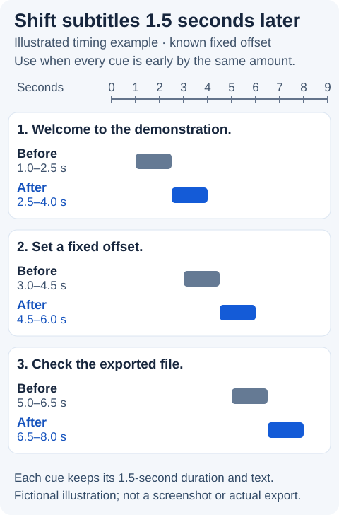

# Two-cue subtitle handoff: SRT to WebVTT

Give a website or video editor a small subtitle pair with an explicit timing change. These original, fictional files are separate from the 19-file version 0.2 handoff ZIP.

- [SRT input](two-cues-original.srt)
- [WebVTT result, shifted 125 ms later](two-cues-shifted-125ms.vtt)

Open each file as UTF-8 text, or use GitHub's **Raw** view to save it. The SRT uses comma milliseconds. The WebVTT adds a `WEBVTT` header and uses decimal points. Cue IDs 7 and 11 and their text are retained.

| Cue | Original start–end | Shifted start–end | Duration, unchanged |
|---|---|---|---|
| 7 | 0.500–1.750 s | 0.625–1.875 s | 1.250 s |
| 11 | 2.250–4.000 s | 2.375–4.125 s | 1.750 s |

Both ends move later by 125 ms; this is a demonstration offset, not a timing recommendation. The text deliberately includes `café` (U+00E9), `café` (U+0065 U+0301) and 🧰✅. The two accented forms remain distinct sequences.

## Try the same conversion

1. Open the free [Subtitle Workbench](https://tooljovia.com/tools/subtitle-workbench/) and paste the complete SRT into Input.
2. Choose SRT input, WebVTT output and a 125 ms shift. Run the tool, review the text and download the result. Load example remains available for the tool's default starter.
3. Tell your recipient which format and offset you are handing over. Check the file in the intended editor or player before using it with real media.

No media is included. This plain two-cue pair does not establish playback synchronisation or compatibility with every player. Conversion runs in your browser without requiring an account or email address.

## Correct captions that appear late

We build ToolJovia. If captions appear 125 ms **late** relative to the audio, use a **-125 ms** shift to move both ends of each cue earlier. A positive shift moves cues later, as in the two-cue example above. These four course captions are fictional.

- [Late SRT input](captions-late-125ms.srt)
- [Expected WebVTT output, shifted 125 ms earlier](captions-corrected-minus-125ms.vtt)

Open the [free Subtitle Workbench](https://tooljovia.com/tools/subtitle-workbench/), paste the SRT, select SRT input and WebVTT output, enter **-125** in Time shift in whole milliseconds, then run, review and download the result. Each cue retains its ID, text and duration; check the file against the audio in your intended player. A negative shift must not place a cue before zero. Processing stays in your browser and no account is needed.

## Demo: shift SRT cues 1.5 seconds later

These three fictional cues demonstrate a **known, constant** offset; no media is included. Compare the [original SRT](demo-original-1500ms.srt) with the [SRT shifted 1,500 ms later](demo-shifted-plus-1500ms.srt). To try it, paste the original into Subtitle Workbench, choose SRT for both source and output, enter **1500** in Time shift in whole milliseconds, then run, review and download. Positive values move cues later; negative values move them earlier. The tool does not detect timing from audio or correct progressive drift. Check the result against your own media in the intended player.



Illustration of the known fixed offset in the sample above.

## Check an overlap before shifting

The workbench applies the same shift to every cue; it does not remove overlaps. Some overlaps are intentional, so first check the video and the recipient's requirements. In this fictional example, assume the captions should appear one at a time:

```srt
1
00:00:01,000 --> 00:00:03,000
The room is ready.

2
00:00:02,500 --> 00:00:04,000
Please take a seat.
```

The first cue ends 500 ms after the second starts. If the audio supports that choice, keep the original file and manually change the first end time to `00:00:02,500` in a text editor. Leave the second cue unchanged. This shortens the first cue, so review its readability and timing; do not make this change blindly.

To apply a known 125 ms delay after that edit, paste the corrected SRT into **Input** in [Subtitle Workbench](https://tooljovia.com/tools/subtitle-workbench/), select **SRT** for **Source format** and **Output**, enter `125` in **Time shift in whole milliseconds**, and select **Run tool**. The expected result is:

```srt
1
00:00:01,125 --> 00:00:02,625
The room is ready.

2
00:00:02,625 --> 00:00:04,125
Please take a seat.
```

Review the output, save it and check it against the intended video and player. No media is included here; the example does not determine the correct timing for your own video.
